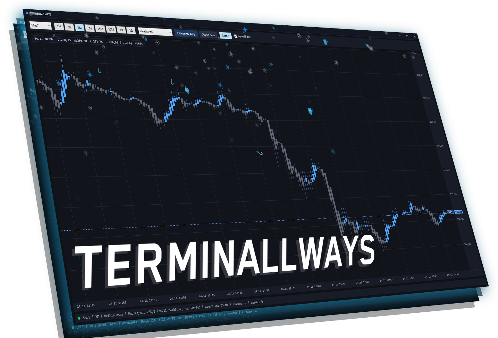

# 🌇🌃 TERMINALLWAYS

> **Кастомный трейдинговый терминал без ограничений**  

> **Статус:** `/!\` В разработке ⚠️😭😂🤗😭 `/!\`

## О проекте

Позволяет реализовать всё, что ограничивают терминалы с подпиской:

- Пользовательские стратегии
- Пользовательские осцилляторы
- Уведомления без ограничений
- Возможность поддержки Windows, Android, WEB
- Возможность подключения Telegram-бота
- Возможность подключения API брокера для реализации сделок напрямую
- Удобный демо-счёт для тестирования стратегий
- Модульность системы для её развития

## Текущий статус

На данный момент проект находится в разработке, но уже имеет основную базу под дальнейшее развитие систем:

- Прямой поток данных с `MOEX ISS` и локальная сборка таймфреймов (`1M`–`1D`)
- Кастомный график (обычные свечи + Heikin Ashi)
- Индикатор торговой сессии, авто-масштабирование, перекрестие и выдвижной бар инструментов

*🍰 Каждый маленький шаг для проекта - это развитие проекта! Сто проц инфо кек 1:1*